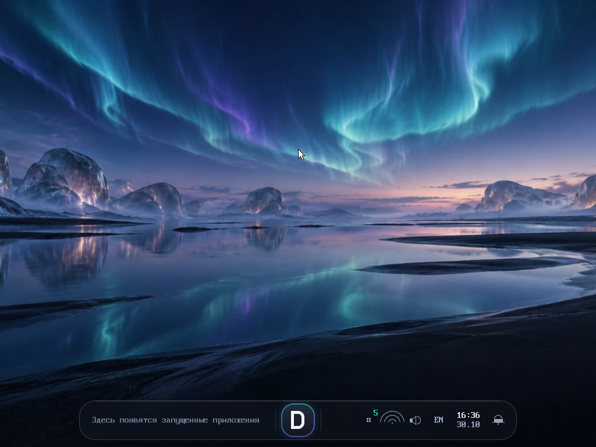
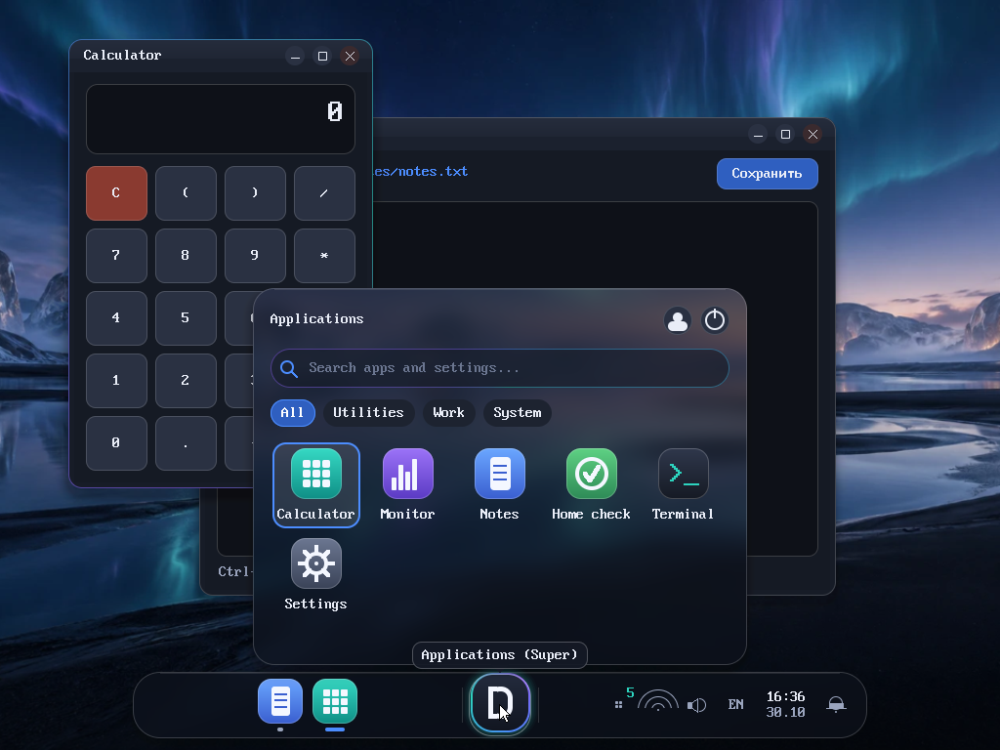
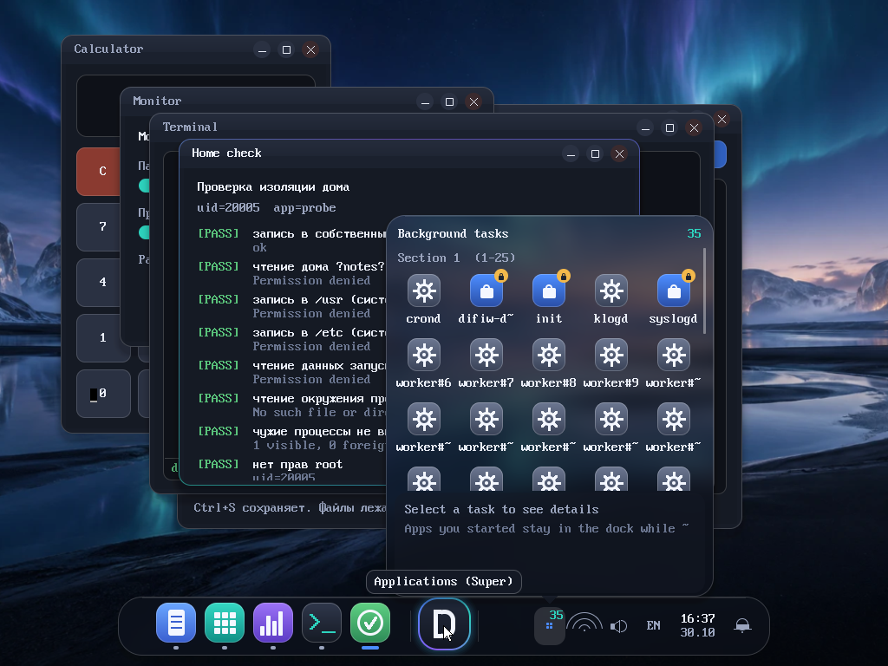

# Difiw OS 0.4.0 Core

Минимальный дистрибутив на основе Linux для x86_64: загрузочный ISO (BIOS, GRUB 2) с собственной
командной оболочкой **Difiw Shell** (C++17).

## Что это и чем пока не является
- Это **Linux-based** система: официальное ядро Linux (без правок), BusyBox, musl и сборка через Buildroot.
  Своё — конфигурация сборки, init/rootfs, оформление, документация и Difiw Shell.
- Это **не** новое ядро, не полноценный дистрибутив и не установщик. Установки на диск, пакетного менеджера,
  сети «из коробки» и UEFI-загрузки в 0.4.0 нет.

## Статус 0.4.0
Фактически проверено (журнал: `docs/verification-log.md`, свежий прогон: `artifacts/verify-report.log`):
- сборка ISO с нуля в WSL2/Ubuntu 24.04;
- загрузка в QEMU и в VirtualBox 7.2 (BIOS), приглашение Difiw Shell на VGA и serial;
- все обязательные команды, `dir`/`cd ..`, `help ru`, Alt+Shift и русский ввод, `reboot` и `poweroff` (QEMU и VirtualBox);
- необязательный диск данных `DIFIWDATA` (ext4) в QEMU;
- простая графическая оболочка `screen --simple` (файлы, редактор, терминал, кнопки питания): QEMU (мышь-планшет,
  клавиатура, сохранение файла) и VirtualBox (запуск, USB-планшет виден в госте);
- **рабочий стол Difiw Desktop** (`screen`): 39 + 9 автоматических проверок в QEMU (панель, кнопка D, фоновые задачи
  >25, окна, изоляция домов, критические службы, анимации, прозрачность, масштаб, разрешение 800x600, автозапуск,
  выключение из рабочего стола) и запуск в VirtualBox.

Не проверено: реальное железо, UEFI, сеть, другие версии VirtualBox.

## Требования
- Linux или Windows 11 + WSL2 (Ubuntu 24.04). Buildroot официально рассчитан на Linux.
- 20+ ГБ свободного места, 4+ ГБ RAM (8 ГБ рекомендуется), интернет для первой сборки.
- Пакеты (Ubuntu/Debian):
  ```bash
  sudo apt-get install -y build-essential git wget curl rsync cpio bc perl python3 unzip file xz-utils bzip2 patch \
       libncurses-dev libssl-dev libelf-dev flex bison xorriso grub-pc-bin grub-common mtools qemu-system-x86 e2fsprogs
  ```

### Windows / WSL2
```powershell
wsl --install -d Ubuntu-24.04     # нужна перезагрузка Windows
```
Сборка идёт в **`~/difiw-build` внутри WSL** (быстро, корректные права и symlink); готовые файлы
копируются в `artifacts/` проекта. Не собирайте на `/mnt/c`/`/mnt/w`. Запуск из PowerShell:
```powershell
powershell -File scripts\wsl.ps1 build
```
Если WSL добавляет в `PATH` каталоги Windows с пробелами, скрипты сами их отбрасывают (Buildroot иначе падает).

## Быстрый старт
В Linux/WSL, из корня проекта:
```bash
./scripts/check-host.sh   # проверка хоста           (make check)
./scripts/build.sh        # получить Buildroot, настроить, собрать, создать ISO   (make build)
./scripts/verify.sh       # проверки + загрузка в QEMU                             (make verify)
```
Результат: `artifacts/difiw-os-0.4.0-x86_64.iso`, `artifacts/SHA256SUMS`, `artifacts/build-report.txt`.
Первая сборка — около 1 часа (toolchain + ядро), повторные — минуты.

Отдельные шаги: `make fetch` (скачать и проверить Buildroot), `make configure` (применить defconfig),
`make run` (запуск в QEMU, выход Ctrl-A X), `make test` (юнит-тесты оболочки на хосте), `make clean`
(удалить output и зеркало; `scripts/clean.sh --all --artifacts` — всё, включая загрузки и ISO),
`make legal-info`.

Скрипт `clean.sh` удаляет только внутри `~/difiw-build`, помеченного файлом `.difiw-build-root`.

## Загрузочная цепочка
```
BIOS -> GRUB 2 (ISO, El Torito) -> Linux bzImage + initramfs (rootfs.cpio.gz в RAM)
     -> /init (BusyBox) -> /etc/inittab -> S10difiw-boot -> difiw-session -> Difiw Shell
```
- GRUB: `console=tty0 console=ttyS0,115200 loglevel=5 vga=792` (VESA 1024x768, нужен для графической оболочки; если
  BIOS не знает такого режима, ядро спросит режим — тогда уберите `vga=792` в `grub.cfg`), таймаут 0 — меню не показывается, система грузится
  сразу (вернуть меню: `set timeout=3` в `buildroot-external/board/difiw/x86_64/grub.cfg`). Вывод дублируется на
  serial, ввод — только клавиатура (чтобы «плавающий» COM1 в VirtualBox не прерывал загрузку).
- Сессия Difiw Shell запускается от root без пароля на `tty1`; на `ttyS0` — только если есть реальный UART
  (QEMU). Это осознанный выбор для локального прототипа: нет сети и нет входа извне.
- Если Difiw Shell не запускается или падает, `difiw-session` печатает причину и запускает `/bin/sh`.
- Выход из оболочки (`exit`, Ctrl+D) запускает новую сессию.

## Структура проекта
```
README.md, LICENSE, VERSION, versions.env, Makefile
scripts/            check-host, fetch-buildroot, sync, configure, build, verify, run-qemu, clean, legal-info, wsl.ps1
src/difiw-shell/    Difiw Shell и простая GUI (C++17)
src/difiw-desktop/  рабочий стол: композитор, оболочка, модель задач, приложения, difiwctl (C++17)
assets/             обои по умолчанию (wallpaper.ppm.gz)
tests/              юнит-тесты, smoke-тест оболочки, автотест QEMU
buildroot-external/ br2-external: defconfig, пакет difiw-shell, board/difiw/x86_64 (overlay, fragments, GRUB, post-*.sh)
docs/               sources.md, licenses.md, verification-log.md, desktop-test-results.md, screenshots/
ARCHITECTURE.md, SECURITY.md, DESIGN.md   архитектура, безопасность, правила дизайна
artifacts/          ISO, SHA256SUMS, отчёты (ISO не коммитится)
```
Buildroot не хранится в репозитории: скачивается и проверяется по SHA-256 из `versions.env`.

## Выбор конфигурации
- **musl**, а не glibc: меньше размер и проще статическая линковка оболочки. Минус — меньшая совместимость
  с чужими бинарниками.
- **initramfs**: rootfs целиком в RAM, ISO остаётся read-only, нет зависимости от драйверов CD-ROM.
- **Только BIOS**: UEFI запланирован на 0.4.0. В VirtualBox отключите EFI.
- Ядро: `x86_64_defconfig` + `board/difiw/x86_64/linux.fragment`; BusyBox: стандартная конфигурация Buildroot +
  `busybox.fragment`. Конфигурация Buildroot: `buildroot-external/configs/difiw_x86_64_defconfig`
  (обновить: `scripts/configure.sh --save`).

## Difiw Shell
Все команды — **встроенные** (реализованы в самой оболочке). Неизвестная команда запускается как внешняя
программа из `PATH` (BusyBox), иначе: `command not found`.

| Команда | Описание | Пример |
|---|---|---|
| `help [команда]` | список команд / справка; `help ru` — на русском, `help en` — на английском | `help del`, `help ru`, `help cd ru` |
| `dir [-a] [путь]` | список как в Windows (даты, размеры, `<DIR>`, итоги) | `dir`, `dir ..\etc` |
| `time` | время `HH:MM:SS (UTC±hh:mm)` | `time` |
| `date` | дата `YYYY-MM-DD, день` | `date` |
| `info` | версия ОС, ядро, hostname, uptime, режим хранения | `info` |
| `mem` | RAM: всего / занято / доступно / свободно | `mem` |
| `disk [path]` | ёмкость файловой системы пути | `disk /data` |
| `size <path>` | размер файла или каталога (рекурсивно, symlink не обходятся) | `size /etc` |
| `ls [-a] [path]` | список; `d` каталог, `-` файл, `l` ссылка | `ls -a /root` |
| `cd [path]` | сменить каталог: `cd ..`, `cd..`, `cd \tmp` (без аргумента — `/root`) | `cd /tmp` |
| `pwd`, `echo`, `ver`, `exit` | вспомогательные | `echo "hi there"` |
| `lang [en\|ru]`, `en`, `ru` | язык сообщений (см. ниже) | `ru` |
| `read <file>` | вывод текстового файла (до 64 КиБ; бинарные отклоняются) | `read /etc/os-release` |
| `clear` | очистка экрана | |
| `mkdir [-p] <path>...` | создать каталоги | `mkdir -p a/b` |
| `touch <path>...` | создать файл / обновить время | `touch notes.txt` |
| `del [-r [-y]] <path>` | удалить файл или пустой каталог; `-r` — с содержимым (с подтверждением) | `del notes.txt` |
| `reboot` | `sync` и перезагрузка | |
| `poweroff` | `sync` и выключение | |

Защита `del`: нельзя удалять `/`, `/root`, `/tmp`, `/data` (сами каталоги), `/etc`, `/usr`, `/bin`, `/sbin`,
`/lib`, `/boot`, `/dev`, `/proc`, `/sys` и всё внутри них (проверяется и по реальному пути, так что symlink не
обойдёт защиту); пустой путь отклоняется; нельзя удалить текущий каталог; `del -r` требует `y` либо флаг `-y`
(без терминала — только с `-y`).

Псевдонимы как в Windows: `cls` = `clear`, `type` = `read`, `md` = `mkdir`, `rd`/`rmdir` = `del`, `chdir` = `cd`.
В путях подходят и `/`, и `\` (`cd \tmp`, `dir ..\etc`); `cd /d путь` тоже принимается.

### Язык и клавиатура
- **Язык сообщений**: команда `ru` (русский), `en` (английский) или `lang ru|en`. Выбор помнится до перезагрузки.
- **Один раз на команду**: `help ru`, `info ru`, `mem en` и т. п.; у любой встроенной команды можно в конце дописать
  `--ru` или `--en` (`ls /nope --ru`). В справке на русском аргументы показаны как `<файл>`, `[путь]`;
  `<x>` — обязательный аргумент, `[x]` — необязательный. (Справка по самой команде `ru`: `help ru ru`.)
- **Русская клавиатура**: на консоли VirtualBox загружается шрифт с кириллицей и раскладка ЙЦУКЕН (как в Windows).
  **Alt+Shift** переключает латиницу и русскую раскладку в любой момент, в том числе в середине строки:
  наберите `echo `, нажмите Alt+Shift и пишите `тест`. Раскладка привязана к физическим клавишам, поэтому язык
  вашей Windows не важен: клавиша с английской `T` даёт `е`. Названия команд остаются латинскими.
- На serial-терминале (QEMU) раскладка не переключается, там действует раскладка вашего терминала.

Парсер: пробелы разделяют аргументы; `'одинарные'` и `"двойные"` кавычки (без escape-последовательностей: кавычку
внутри берите кавычкой другого вида); `\` — обычный символ; `#` в начале слова — комментарий. **Нет** конвейеров,
перенаправлений, переменных и подстановок (`*`). Строка — до 4095 символов. Ошибки печатаются как `difiw: <команда>: <причина>`; оболочка не завершается.
Коды: 0 успех, 1 ошибка операции, 2 неверные аргументы, 3 отказ защиты.

## Графический рабочий стол Difiw Desktop (`screen`)
Загрузка идёт в **текстовый терминал**. Команда `screen` запускает рабочий стол; в нём есть приложение
**Терминал**, где команда `terminal` закрывает рабочий стол и возвращает текстовую консоль. Автозапуск при
загрузке: добавьте `difiw.desktop=1` в строку `linux` файла `buildroot-external/board/difiw/x86_64/grub.cfg`.



- **Обои** по умолчанию (`assets/wallpaper.ppm.gz`) — отдельный слой; панель, окна и меню рисуются поверх.
- **Нижняя плавающая капсула**: слева **только запущенные вами приложения с окном** (значок, индикатор работы,
  отдельный вид активного окна, число окон, наведение, контекстное меню правой кнопкой, закрытие, группировка окон
  приложения; при нехватке места — стрелки и плавная прокрутка), по центру кнопка **D**, справа системная область
  (фоновые задачи, сеть, звук, батарея если есть, раскладка, часы и календарь, уведомления).
- **Меню D** открывается над кнопкой: поиск (в том числе по-русски), категории, сетка приложений с постраничной
  прокруткой, профиль, питание (выключение / перезагрузка / выход в консоль), «Параметры». Клавиатура: Super открывает меню,
  стрелки/Tab/Enter, набор текста — поиск.
- **Фоновые задачи**: службы системы и приложения без окна; показываются значок, имя, состояние, ОЗУ и CPU; одна секция
  вмещает 25 элементов, остальные идут в следующую секции с прокруткой; критические (`init`, `syslogd`, `difiw-desktop`)
  помечены замком и не завершаются; остальные завершаются только после подтверждения.
- **Окна**: перемещение, изменение размера, сворачивание, разворачивание (двойной щелчок по заголовку), Alt+Tab, Alt+F4,
  несколько окон одного приложения.
- **«Дом» каждого приложения**: отдельный пользователь (UID 20001+) и каталог `/homes/user/apps/<app-id>/` (`0700`).
  Честное описание границ — в [SECURITY.md](SECURITY.md).
- **Настройки** (меню D → Параметры): меньше движения, прозрачность, масштаб 100/200%, язык RU/EN. Файл `/etc/difiw/desktop.conf`.
- **Тестовые приложения**: Заметки, Калькулятор, Терминал, Монитор, Проверка дома (проверяет изоляцию из-под своего UID),
  фоновый воркер и тест прав (скрытые).
- **`difiwctl`** (root): `launch <app>`, `windows`, `tasks`, `dock`, `popup menu|tasks|net|...`, `shot FILE`, `close <iid>`,
  `kill-task <key>`, `set scale|reduce|transparency|lang ...`, `quit`.

Для мыши в VirtualBox выберите **USB-планшет** (`VBoxManage modifyvm "<VM>" --mouse usbtablet`).
Документы: [ARCHITECTURE.md](ARCHITECTURE.md), [SECURITY.md](SECURITY.md), [DESIGN.md](DESIGN.md),
результаты проверок — [docs/desktop-test-results.md](docs/desktop-test-results.md). Прежняя простая оболочка в одном
окне осталась как `screen --simple`.




## Простая графическая оболочка (`screen --simple`)
Загрузка идёт в **текстовый терминал**. Команда `screen` запускает простую графическую оболочку `difiw-gui`
(рисует прямо в framebuffer, без X11; мышь и клавиатура — через evdev):
- вкладки **Файлы** (F1), **Редактор** (F2), **Терминал** (F3);
- **Файлы**: список папки, «Вверх», «Обновить», быстрые переходы `/root` `/tmp` (`/data`, если подключён диск),
  «Новый файл», «Новая папка», «Открыть» (или двойной щелчок), «Удалить» (с подтверждением; системные пути и непустые
  папки не удаляются);
- **Редактор**: ввод текста, Enter, Backspace/Delete, стрелки, Home/End, PgUp/PgDn, щелчок ставит курсор;
  **Сохранить** (кнопка или Ctrl+S), «Закрыть» спрашивает, если есть несохранённые изменения; файлы до 256 КиБ, текстовые;
- **Терминал**: те же команды, что в текстовой консоли (запускает `difiw-shell -c`), история стрелками вверх/вниз,
  PgUp/PgDn — прокрутка; команда **`terminal`** закрывает графику и возвращает текстовую консоль, `screen` в консоли
  снова открывает графику;
- верхняя панель: часы, переключатель языка интерфейса RU/EN, **Консоль** (выход в текстовый терминал),
  **Перезагрузка** и **Выключение** (оба с подтверждением);
- русская раскладка: **Alt+Shift** (индикатор внизу), независимо от раскладки вашей Windows.

Для мыши в VirtualBox выберите «Указывающее устройство» = **USB-планшет** (тогда курсор свободно переходит между
Windows и VM без захвата). Все файлы в графической оболочке лежат в RAM и пропадают после перезагрузки (кроме `/data`).
Если графика недоступна, `screen` сообщит об ошибке и останется в текстовой консоли.

## Постоянное хранение (честно)
- **По умолчанию всё в RAM**: файлы в `/root`, `/tmp` и т. д. пропадают после `reboot`. Это проверено.
- Подключённый диск сам по себе ничего не сохраняет. Реализовано **опциональное расширение**: если есть диск
  с ext4 и меткой `DIFIWDATA`, при загрузке он монтируется в `/data`, и там данные переживают перезагрузку
  (проверено в QEMU; в VirtualBox не проверялось). Подготовка диска на хосте:
  ```bash
  truncate -s 256M data.img && mkfs.ext4 -L DIFIWDATA data.img
  DATA_DISK=data.img ./scripts/run-qemu.sh
  ```
  В VirtualBox: сконвертируйте образ (`VBoxManage convertfromraw`) и подключите как диск. В ОС нет `mkfs`
  и установки на диск.

## Запуск в QEMU
```bash
./scripts/run-qemu.sh                  # serial в терминале, выход: Ctrl-A X
```
`./scripts/verify.sh` автоматически загружает ISO, выполняет команды, проверяет `poweroff`, `reboot` и диск данных.

## Запуск в VirtualBox
1. Создать VM: тип **Linux**, версия **Other Linux (64-bit)**.
2. 1–2 CPU, 512 МБ–1 ГБ RAM, жёсткий диск не нужен.
3. Система → **отключить EFI** (только BIOS).
4. Носители: подключить `artifacts/difiw-os-0.4.0-x86_64.iso` как оптический диск; порядок загрузки — оптический первым.
5. Для графики: Система → Указывающее устройство → **USB-планшет** (`VBoxManage modifyvm "<VM>" --mouse usbtablet`).
6. Запустить. Ожидается: сразу сообщения ядра (меню GRUB не показывается) → логотип и приглашение `difiw:/root>`;
   команда `screen` открывает графическую оболочку.
7. `poweroff` выключает VM, `reboot` перезапускает.

## Известные ограничения
- Только BIOS, только x86_64; нет установки на диск и сети по умолчанию.
- Данные в RAM (кроме опционального `/data`); размер tmpfs = половина RAM.
- Вход root без пароля — только для локального прототипа.
- Нет истории и редактирования строки (только возможности терминала), нет конвейеров.
- Графическая оболочка минимальна: одно окно с вкладками, нет окон, значков, изображений, копирования-вставки; только текстовые файлы до 256 КиБ.
- Часовой пояс — UTC; время берётся из RTC виртуальной машины и может отличаться от хостовых часов.
- Ядро Linux — «последнее» из Buildroot (7.1.x), не LTS.
- Если ядро печатает `regulatory.db` / `amd_pstate` — это безвредные сообщения виртуального окружения.

## Устранение неполадок
- **`Your PATH contains spaces`** — запускайте через `scripts/*.sh` (они чистят `PATH`) или уберите Windows-пути из PATH WSL.
- **`Temporary failure in name resolution`** при загрузке исходников — временный сбой DNS в WSL; повторите `./scripts/build.sh` (продолжит с места остановки). `wsl --shutdown` и повтор помогают при постоянных сбоях.
- **`grub-mkrescue: not found` / `xorriso` / `mformat`** — установите `grub-pc-bin grub-common xorriso mtools`.
- **Медленная сборка / ошибки прав** — проект собирается в `~/difiw-build`, а не на `/mnt/*`.
- **VirtualBox: после выбора пункта GRUB чёрный экран, мигает курсор, ничего не появляется** — VM создана
  с типом `Other/Unknown` (32-битный режим). Ядро Difiw OS — x86_64. Настройки → Общие → Основные → Тип
  **Linux**, версия **Other Linux (64-bit)**. Проверка: `VBoxManage showvminfo "<имя>" --machinereadable | findstr longmode`
  должно быть `longmode="on"`.
- **VirtualBox показывает `no bootable medium`** — проверьте, что ISO подключён и EFI отключён.
- **VirtualBox не стартует при включённом Hyper-V/WSL2** — используйте VirtualBox 7+, он работает поверх Hyper-V; при VERR_NEM_* обновите VirtualBox.
- Чистая пересборка: `./scripts/clean.sh && ./scripts/build.sh`.

## Дальнейшее развитие (0.4.0+)
Рабочий стол: векторный шрифт, настоящее размытие, диалог выбора файлов и просмотр/отзыв разрешений,
seccomp/cgroups/namespaces для приложений, установка приложений, звук. Система: UEFI, установка на диск,
история команд/редактирование строки, конвейеры и перенаправления, сеть,
автоматическая разметка постоянного хранилища, аудит лицензий перед публикацией ISO.

## Лицензия
Собственный код — MIT (`LICENSE`). Linux, Buildroot, BusyBox, musl, GRUB и др. — под своими лицензиями
(`docs/licenses.md`, `make legal-info`). Перед публичным распространением ISO нужен отдельный license audit.
