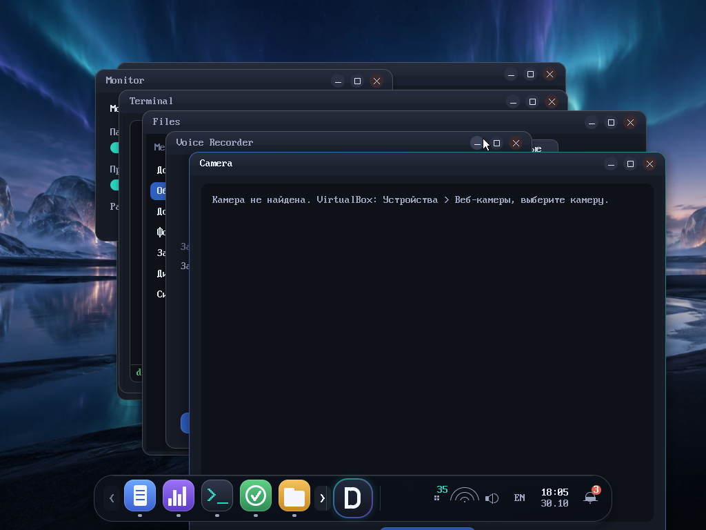
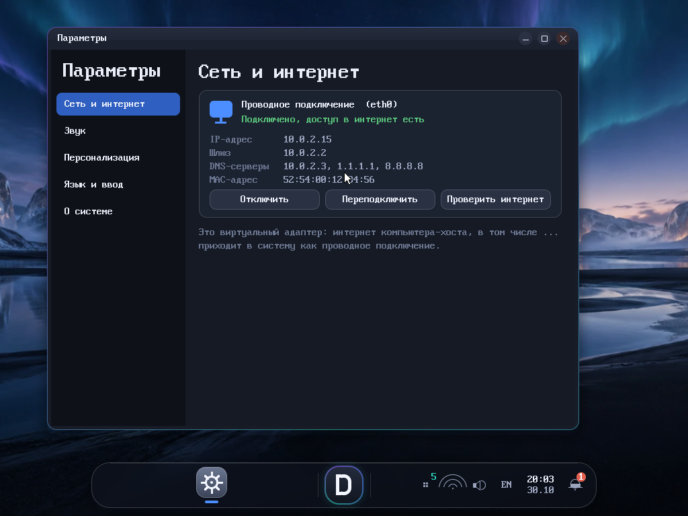
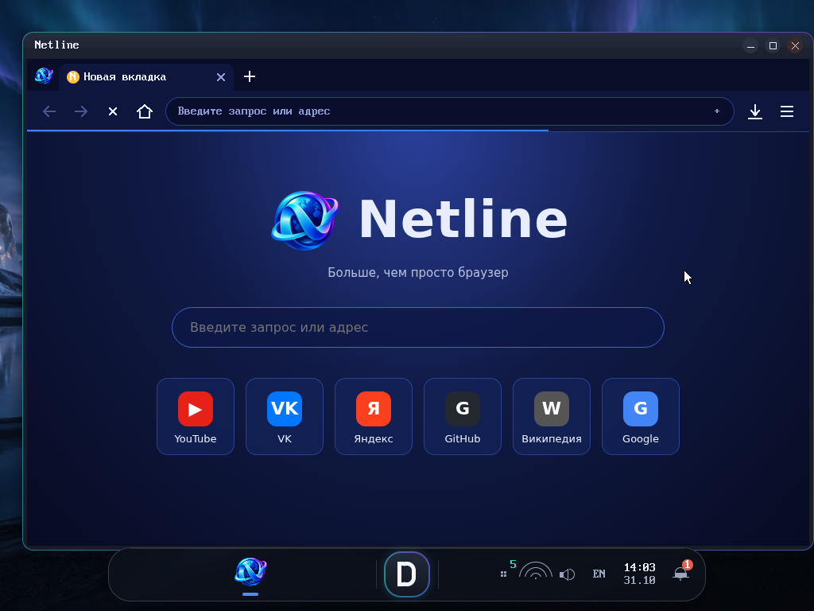
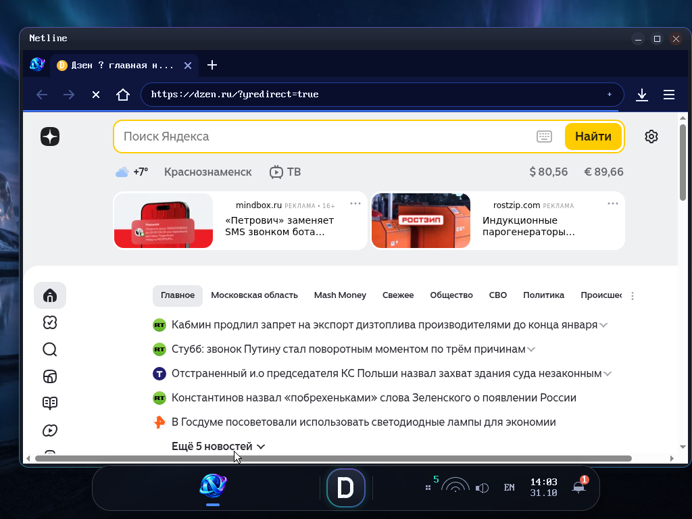

<div align="center">


# Difiw OS

**A small Linux-based operating system with its own desktop, shell and apps.**

🇬🇧 English · [🇷🇺 Русский](README.ru.md) · [📘 Manual (RU)](docs/manual.ru.md)

  

</div>



Difiw OS boots from a single ISO (BIOS, GRUB 2) in VirtualBox, QEMU or on real hardware. It is built with [Buildroot](https://buildroot.org/) on top of the official Linux kernel; the desktop, compositor, shell and apps are written from scratch in C++.

## ⬇ Download

Pick a version and click **Download** (one file, no need to clone the repository). Checksums: [SHA256SUMS](https://github.com/Difiw/DifiwOS/raw/iso-releases/SHA256SUMS). All images live in the [`iso-releases`](../../tree/iso-releases) branch.

| Version | What's inside | Size | Link |
|---------|---------------|------|------|
| **0.5.6** (latest) | Netline on Chromium (CEF), glibc, needs 4 GB RAM | 196 MB | [⬇ Download](https://github.com/Difiw/DifiwOS/raw/iso-releases/difiw-os-0.5.6-x86_64.iso) |
| **0.5.5** | Latest stable: Yandex search in Netline, saved cookies | 36.0 MB | [⬇ Download](https://github.com/Difiw/DifiwOS/raw/iso-releases/difiw-os-0.5.5-x86_64.iso) |
| **0.5.4** | Netline search fixes | 30.0 MB | [⬇ Download](https://github.com/Difiw/DifiwOS/raw/iso-releases/difiw-os-0.5.4-x86_64.iso) |
| **0.5.3** | Network panel, sound devices, Settings pages | 30.0 MB | [⬇ Download](https://github.com/Difiw/DifiwOS/raw/iso-releases/difiw-os-0.5.3-x86_64.iso) |
| **0.5.2** | First Netline browser | 29.8 MB | [⬇ Download](https://github.com/Difiw/DifiwOS/raw/iso-releases/difiw-os-0.5.2-x86_64.iso) |
| **0.5.1** | Settings app, notifications | 29.7 MB | [⬇ Download](https://github.com/Difiw/DifiwOS/raw/iso-releases/difiw-os-0.5.1-x86_64.iso) |
| **0.5.0** | Network, sound, Files, Recorder, Camera | 25.6 MB | [⬇ Download](https://github.com/Difiw/DifiwOS/raw/iso-releases/difiw-os-0.5.0-x86_64.iso) |
| **0.4.0** | Difiw Desktop (compositor, dock) | 24.0 MB | [⬇ Download](https://github.com/Difiw/DifiwOS/raw/iso-releases/difiw-os-0.4.0-x86_64.iso) |
| **0.3.0** | Graphical shell, files/editor/terminal | 21.8 MB | [⬇ Download](https://github.com/Difiw/DifiwOS/raw/iso-releases/difiw-os-0.3.0-x86_64.iso) |
| **0.2.0** | Difiw Shell, en/ru | 21.5 MB | [⬇ Download](https://github.com/Difiw/DifiwOS/raw/iso-releases/difiw-os-0.2.0-x86_64.iso) |

## What you get

- **Difiw Desktop** – own compositor with a floating dock, task model, per-app unprivileged users and home folders.
- **Difiw Shell** – command shell with English/Russian UI (Alt+Shift switches the keyboard layout).
- **Apps** – Files, Notepad, Terminal, Monitor, Voice Recorder, Camera, Settings (network, sound, personalisation).
- **Network and sound** – DHCP networking, ALSA audio, USB webcam.
- **Netline** – a real web browser: Chromium 156 via the Chromium Embedded Framework (JavaScript, modern CSS, HTTPS, cookies, localStorage/IndexedDB, WebSocket, WebAssembly). Yandex is the default search engine (switchable in the menu).



## Netline browser

Tabs, address bar, menu, bookmarks, history and downloads are drawn by Difiw itself; web pages are rendered by CEF in off-screen mode.





Shortcuts: `Ctrl+T` new tab, `Ctrl+W` close, `Ctrl+L` address bar, `Ctrl+R`/`F5` reload, `Ctrl+Tab` next tab, `Ctrl+Shift+T` reopen closed tab, `Ctrl+F` find, `Ctrl+D` bookmark, `Ctrl+H` history, `Ctrl+J` downloads, `Ctrl +/-` zoom, `Ctrl+Shift+N` private window.

**Status:** Netline runs inside the Difiw OS 0.5.6 ISO (VirtualBox, 4 GB RAM) and opens real HTTPS sites with JavaScript. The engine and UI are also verified on a regular Linux desktop (WSL2) with a local test stand and sites (ya.ru, yandex.ru, vk.com, github.com, youtube.com, ru.wikipedia.org). Not yet tested inside the ISO: typing on the keyboard, sound/video, memory/CPU measurements, long-running stability; see [docs/netline-test-results.md](docs/netline-test-results.md). Proprietary codecs (H.264/AAC) and DRM are not part of the CEF build, so some video may not play. The OS in this release is built on **glibc** (CEF exists for glibc only); give the VM **at least 4 GB of RAM**. The ISO is about 200 MB and is stored in the `iso-releases` branch with Git LFS (use the download link in the table).

Build and try Netline on a normal Linux desktop (SDL2):

```bash
./scripts/fetch-cef.sh
cd src/netline-cef && cmake -S . -B build -G Ninja -DNETLINE_BACKEND=sdl && cmake --build build
./build/netline https://ya.ru
```

## Run it in VirtualBox

1. Create a VM: **Type** Linux, **Version** Other Linux (64-bit), 2 CPUs, **4 GB RAM or more**. No hard disk is needed (an empty disk is formatted once and keeps your settings).
2. System → **disable EFI** (BIOS only). System → Pointing device → **USB Tablet**. Network: NAT.
3. Storage → attach the downloaded ISO to the optical drive and boot from it.
4. At the `difiw:/root>` prompt type `screen` to start the graphical desktop. `poweroff` / `reboot` work as expected.

### QEMU

```bash
qemu-system-x86_64 -m 4096 -cdrom difiw-os-<version>-x86_64.iso -vga std -netdev user,id=n0 -device e1000,netdev=n0
```

## Build from source

Needs Linux (or WSL2 with Ubuntu 24.04), about 30 GB of disk and an hour or more for the first build.

```bash
./scripts/build-glibc.sh   # Buildroot + official CEF (SHA-1 checked), ISO goes to artifacts/
./scripts/verify.sh    # boots it in QEMU and checks the basics
```

## Repository layout

| Path | Contents |
|------|----------|
| `src/difiw-desktop` | compositor, desktop, apps, client library |
| `src/difiw-shell` | Difiw Shell |
| `buildroot-external` | Buildroot defconfig, packages, overlay, kernel fragment |
| `scripts` | build, run and verification scripts |
| `tests`, `docs` | QEMU tests, licenses, logs, screenshots |

## License

Difiw OS code is MIT licensed; third-party components keep their own licenses, see [docs/licenses.md](docs/licenses.md).
