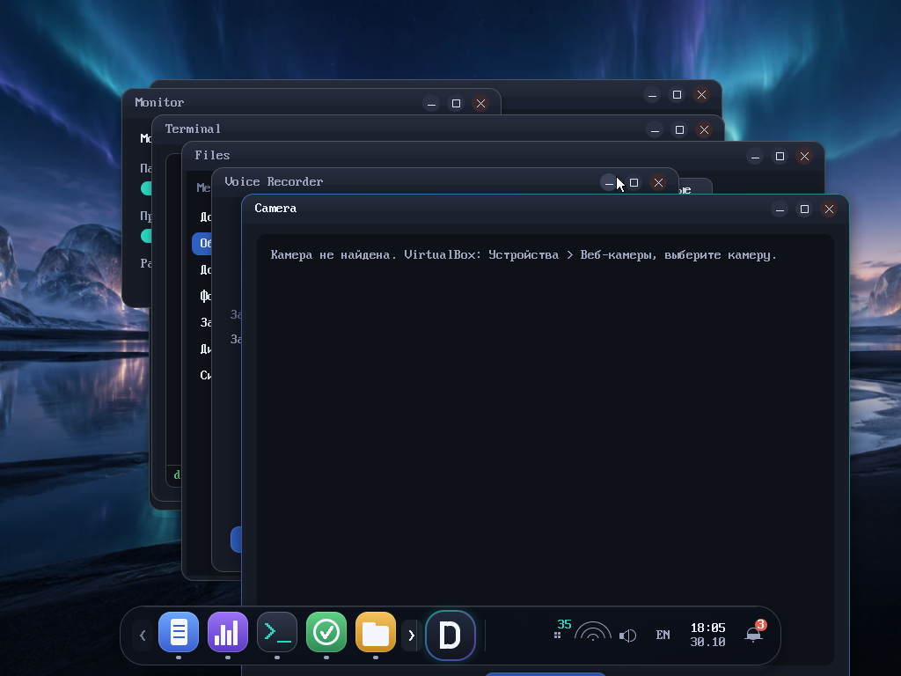
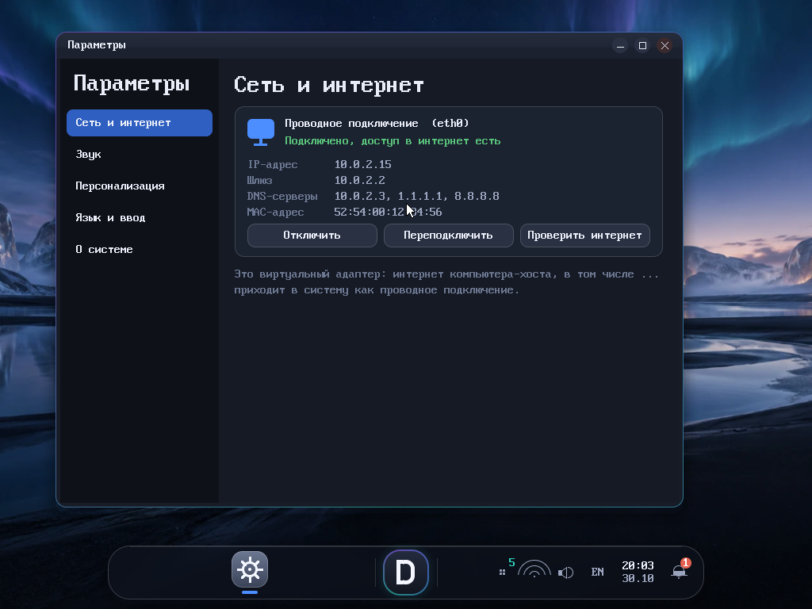

<div align="center">


# Difiw OS

**Небольшая операционная система на базе Linux со своим рабочим столом, оболочкой и приложениями.**

[🇬🇧 English](README.md) · 🇷🇺 Русский · [📘 Руководство](docs/manual.ru.md)

  

</div>



Difiw OS загружается с одного ISO (BIOS, GRUB 2) в VirtualBox, QEMU или на реальном железе. Собирается через [Buildroot](https://buildroot.org/) на официальном ядре Linux; рабочий стол, композитор, оболочка и приложения написаны с нуля на C++.

## ⬇ Скачать

Выберите версию и нажмите **Скачать** — загружается один файл, клонировать репозиторий не нужно. Контрольные суммы: [SHA256SUMS](https://github.com/Difiw/DifiwOS/raw/iso-releases/SHA256SUMS). Все образы лежат в ветке [`iso-releases`](../../tree/iso-releases).

| Версия | Что внутри | Размер | Ссылка |
|--------|------------|--------|--------|
| **0.5.5** | Последняя стабильная: поиск Яндекс в Netline, cookies | 36.0 МБ | [⬇ Скачать](https://github.com/Difiw/DifiwOS/raw/iso-releases/difiw-os-0.5.5-x86_64.iso) |
| **0.5.4** | Исправления поиска Netline | 30.0 МБ | [⬇ Скачать](https://github.com/Difiw/DifiwOS/raw/iso-releases/difiw-os-0.5.4-x86_64.iso) |
| **0.5.3** | Сетевая панель, устройства звука, Параметры | 30.0 МБ | [⬇ Скачать](https://github.com/Difiw/DifiwOS/raw/iso-releases/difiw-os-0.5.3-x86_64.iso) |
| **0.5.2** | Первый браузер Netline | 29.8 МБ | [⬇ Скачать](https://github.com/Difiw/DifiwOS/raw/iso-releases/difiw-os-0.5.2-x86_64.iso) |
| **0.5.1** | Параметры, уведомления | 29.7 МБ | [⬇ Скачать](https://github.com/Difiw/DifiwOS/raw/iso-releases/difiw-os-0.5.1-x86_64.iso) |
| **0.5.0** | Сеть, звук, Файлы, Диктофон, Камера | 25.6 МБ | [⬇ Скачать](https://github.com/Difiw/DifiwOS/raw/iso-releases/difiw-os-0.5.0-x86_64.iso) |
| **0.4.0** | Difiw Desktop (композитор, док) | 24.0 МБ | [⬇ Скачать](https://github.com/Difiw/DifiwOS/raw/iso-releases/difiw-os-0.4.0-x86_64.iso) |
| **0.3.0** | Графическая оболочка, файлы/редактор/терминал | 21.8 МБ | [⬇ Скачать](https://github.com/Difiw/DifiwOS/raw/iso-releases/difiw-os-0.3.0-x86_64.iso) |
| **0.2.0** | Difiw Shell, en/ru | 21.5 МБ | [⬇ Скачать](https://github.com/Difiw/DifiwOS/raw/iso-releases/difiw-os-0.2.0-x86_64.iso) |

> В разработке: **0.5.6** (Netline на Chromium) — в ветке [`0.5.6`](../../tree/0.5.6), ещё не выпущена.

## Что есть

- **Difiw Desktop** — свой композитор, плавающий док, модель задач, отдельные непривилегированные пользователи и домашние папки для каждого приложения.
- **Difiw Shell** — командная оболочка на русском и английском (Alt+Shift переключает раскладку).
- **Приложения** — Файлы, Блокнот, Терминал, Монитор, Диктофон, Камера, Параметры (сеть, звук, персонализация).
- **Сеть и звук** — DHCP, звук ALSA, USB-камера.
- **Netline** — встроенный браузер (вкладки, закладки, загрузки, поиск по умолчанию — Яндекс). В 0.5.5 это лёгкий движок **без JavaScript**, поэтому сайты-приложения пока не работают.



## Запуск в VirtualBox

1. Создайте ВМ: тип **Linux**, версия **Other Linux (64-bit)**, 1–2 CPU, 1 ГБ ОЗУ. Диск не нужен (пустой диск один раз форматируется и хранит настройки).
2. Система → **отключить EFI** (только BIOS). Система → Указывающее устройство → **USB-планшет**. Сеть: NAT.
3. Носители → подключите скачанный ISO к оптическому приводу и загрузитесь с него.
4. В приглашении `difiw:/root>` введите `screen` — запустится графический рабочий стол. `poweroff` и `reboot` выключают и перезагружают систему.

### QEMU

```bash
qemu-system-x86_64 -m 1024 -cdrom difiw-os-0.5.5-x86_64.iso -vga std -netdev user,id=n0 -device e1000,netdev=n0
```

## Сборка из исходников

Нужен Linux (или WSL2 с Ubuntu 24.04), около 30 ГБ диска и час-другой на первую сборку.

```bash
./scripts/build.sh     # скачивает Buildroot и собирает ISO в artifacts/
./scripts/verify.sh    # загружает его в QEMU и проверяет основное
```

## Структура репозитория

| Путь | Содержимое |
|------|-----------|
| `src/difiw-desktop` | композитор, рабочий стол, приложения, клиентская библиотека |
| `src/difiw-shell` | Difiw Shell |
| `buildroot-external` | defconfig Buildroot, пакеты, оверлей, фрагмент ядра |
| `scripts` | скрипты сборки, запуска и проверки |
| `tests`, `docs` | тесты в QEMU, лицензии, логи, скриншоты |

## Лицензия

Код Difiw OS — MIT; сторонние компоненты сохраняют свои лицензии, см. [docs/licenses.md](docs/licenses.md).
